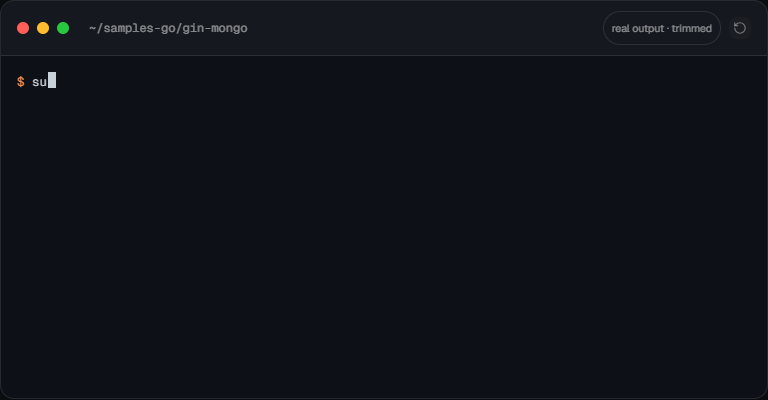
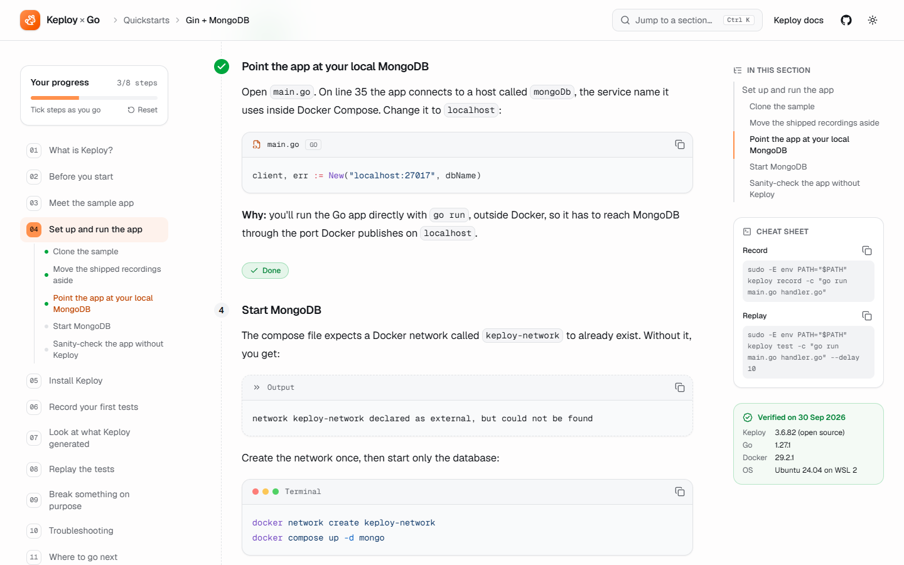
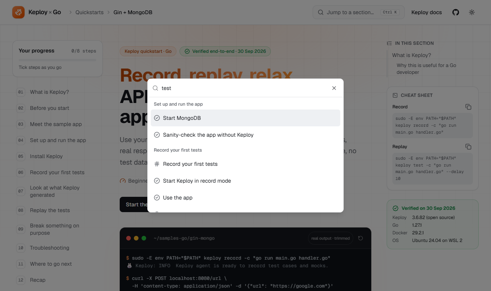
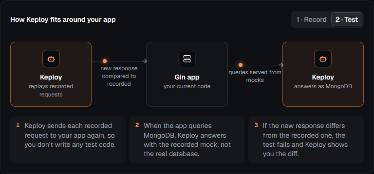
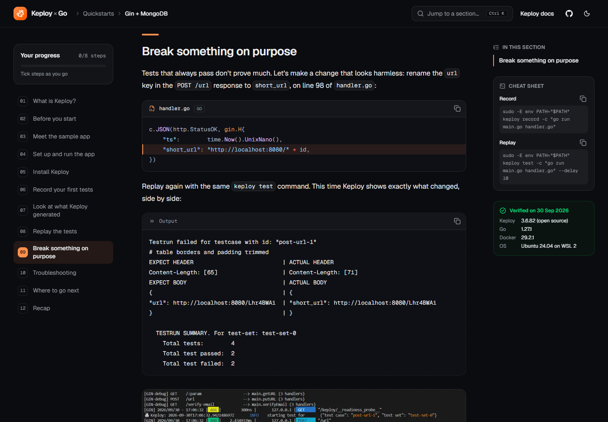
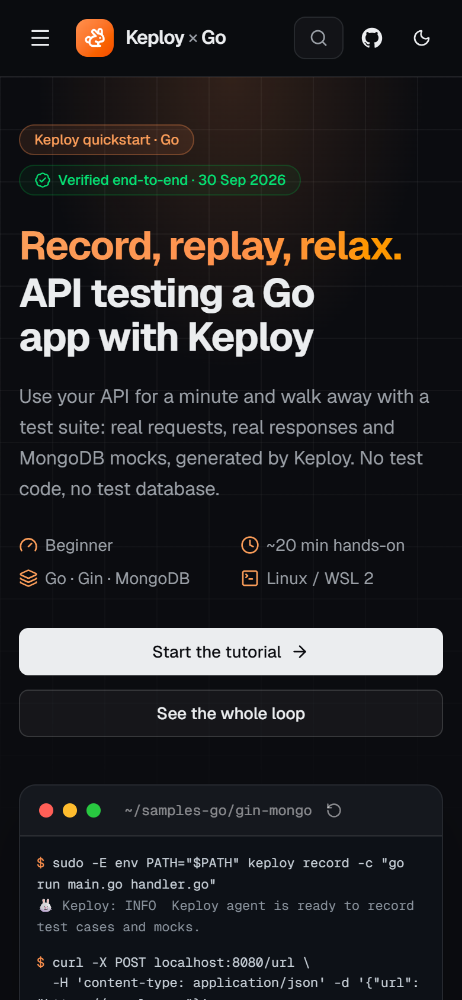
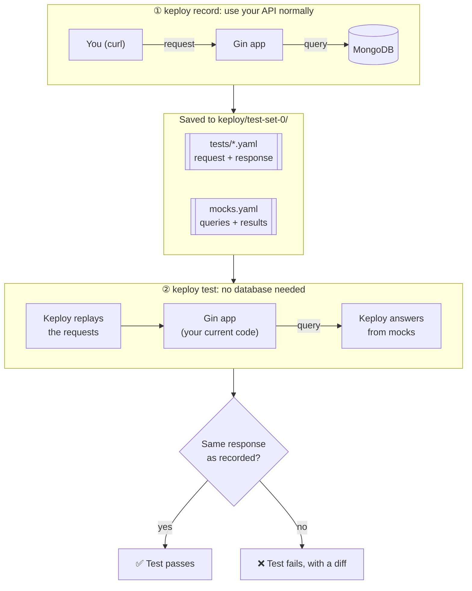
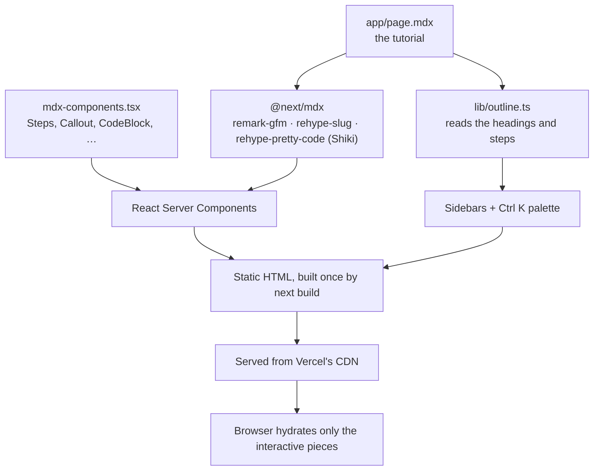

<div align="center">


# Record, Replay, Relax

### API testing a Go app with Keploy: a beginner-friendly, hands-on tutorial

Use your API for a minute and walk away with a test suite: real requests, real responses and MongoDB mocks, generated by [Keploy](https://keploy.io). No test code, no test database.

[](https://keploy-go-quickstart-tutorial.vercel.app)


**[Read the tutorial](https://keploy-go-quickstart-tutorial.vercel.app)** · [What I found](#-what-i-found-along-the-way) · [How it's built](#-how-the-site-is-built) · [Run it locally](#-run-it-locally)

<br>



<sub>Real commands and output from my run, trimmed. The same animation opens the live site.</sub>

</div>

---

## 📌 About

This repository is my submission for **Keploy's DevRel assignment**: learn a Keploy Go quickstart, run it, then teach it to a developer who has never used Keploy, as a single-page documentation site built with **Next.js and MDX**.

I picked the **Gin + MongoDB** quickstart because its database dependency shows off what makes Keploy different: it records not just your API's traffic but your app's calls to MongoDB, then replays everything with the database switched off.

> **Every command and output on the page comes from a real run** (long outputs are trimmed and marked as such). The troubleshooting section separates the issues I actually hit from the general ones.

## ✨ Highlights

<table>
  <tr>
    <td width="50%" valign="top">
      
      <p><b>Tutorial-first UX.</b> Numbered steps you can tick off. Progress is saved in your browser and shown in the sidebar, so you can leave and pick up where you stopped.</p>
    </td>
    <td width="50%" valign="top">
      
      <p><b>Jump anywhere.</b> <kbd>Ctrl</kbd>/<kbd>⌘</kbd> + <kbd>K</kbd> searches every section and step. A reading-progress bar and "In this section" rail keep you oriented.</p>
    </td>
  </tr>
  <tr>
    <td width="50%" valign="top">
      
      <p><b>Explains the "why".</b> An interactive Record / Test diagram with animated traffic, plus glossary hover cards for terms like <i>mock</i>, <i>noise</i> and <i>eBPF</i>.</p>
    </td>
    <td width="50%" valign="top">
      
      <p><b>Shows the payoff.</b> The tutorial breaks the API on purpose and shows Keploy catching it, with the real expected-vs-actual diff and terminal screenshots.</p>
    </td>
  </tr>
</table>

<table>
  <tr>
    <td width="28%" valign="top" align="center">
      
    </td>
    <td valign="top">
      <h3>Built for every screen</h3>
      <ul>
        <li>Responsive from <b>320px</b> phones to wide desktops, verified with zero horizontal overflow at 9 widths</li>
        <li>Light and dark themes that follow your system, with no flash on load</li>
        <li>Code blocks with terminal chrome, filename tabs, an output style and one-click copy</li>
        <li>Keyboard accessible, with visible focus rings; respects <code>prefers-reduced-motion</code></li>
        <li>Fully static: prerendered HTML on Vercel's CDN, with no server or database</li>
        <li>Generated Open Graph image, so the link previews nicely when shared</li>
      </ul>
    </td>
  </tr>
</table>

## 📖 What the tutorial covers

| # | Section | What you get |
|---|---|---|
| 1 | **What is Keploy?** | The idea in plain words: test cases from traffic, mocks from dependency calls |
| 2 | **Before you start** | Prerequisites, plus the exact versions I used |
| 3 | **Meet the sample app** | A Gin URL shortener backed by MongoDB, and its endpoints |
| 4 | **Set up and run the app** | Clone, configure, and sanity-check without Keploy first |
| 5 | **Install Keploy** | The open-source build, and why `sudo` needs your `PATH` |
| 6 | **Record your first tests** | `keploy record`, then real `curl` traffic |
| 7 | **Look at what Keploy generated** | An annotated test case, and what's inside `mocks.yaml` |
| 8 | **Replay the tests** | `keploy test`: 4/4 passing, **even with MongoDB stopped** |
| 9 | **Break something on purpose** | Rename one JSON key and watch 2 tests fail with a diff |
| 10 | **Troubleshooting** | "Issues I hit" vs. "other common issues" |

## 🔍 What I found along the way

Following the official quickstart closely surfaced a few things a first-time user would trip over. The tutorial handles each one, and each could become a small fix in the official docs:

| Finding | How the tutorial handles it |
|---|---|
| `docker compose up mongo` fails with *"network keploy-network declared as external, but could not be found"* | Adds `docker network create keploy-network` before starting MongoDB |
| The MongoDB address to change is on **line 35** of `main.go` (the docs say line 21) | Shows the exact line to edit |
| The sample repo ships its own `keploy/` folder of old recordings | Moves it aside so your run starts clean |
| `keploy test` for the local (non-Compose) setup isn't shown; the page repeats the Compose command | Uses the command that worked: `keploy test -c "go run main.go handler.go" --delay 10` |
| Plain `sudo keploy` loses your `PATH`, so `keploy` and `go` aren't found | Uses `sudo -E env PATH="$PATH" keploy ...`, which is what the install script's alias does |
| The install script defaults to the paid-features build; `--oss` installs the open-source one | Installs the open-source release and explains the difference |
| Test files are named `post-url-1.yaml` and so on, not `test-1.yaml` | Shows the real folder tree |
| 💡 **A-ha:** Keploy detected the changing `ts` timestamp and `Date` header and marked them as noise automatically | Called out as the "a-ha" moment, with the annotated YAML |

<details>
<summary><b>Verified environment</b></summary>

| | |
|---|---|
| Date | 30 Sep 2026 |
| Keploy | 3.6.82 (open-source build) |
| Go | 1.27.1 |
| Docker | 29.2.1 (Docker Desktop) |
| OS | Ubuntu 24.04 on WSL 2 (kernel 6.6), Windows 11 |
| Sample | [`keploy/samples-go/gin-mongo`](https://github.com/keploy/samples-go/tree/main/gin-mongo) |

</details>

## 🧭 How Keploy works, in one picture



## 🏗 How the site is built



- **Content is MDX.** The tutorial is one file, [`app/page.mdx`](app/page.mdx): Markdown for prose, React components where they help (`<Steps>`, `<Callout>`, `<KeployFlow>`, `<Term>`).
- **Highlighting happens at build time.** Shiki colors code during the build, so readers download no highlighter JavaScript, and light and dark themes switch with CSS.
- **Navigation is built from the source.** [`lib/outline.ts`](lib/outline.ts) parses `page.mdx` at build time using the same slug algorithm as `rehype-slug`, so the sidebars and palette are in the static HTML and never pop in.
- **Server Components by default.** Only interactive pieces ship JavaScript: theme toggle, copy buttons, step progress, command palette, sidebars, tabs, accordion and the hero terminal.
- **State without a backend.** Step progress uses `useSyncExternalStore` over `localStorage`, so every component stays in sync without a server.

### Design decisions

| Decision | Why |
|---|---|
| Keploy's brand orange `#FF914D` for fills, plus a deeper "ink" shade for text | The site feels part of Keploy's ecosystem while keeping text at WCAG AA contrast |
| shadcn/ui on Radix | Accessible Tabs, Accordion, Dialog and Sheet out of the box, with the source in the repo so it's easy to adapt |
| Custom components for the teaching pieces (`Steps`, `Callout`, `Term`, `KeployFlow`) | These carry the tutorial, so they're purpose-built and small |
| Commands and output in separate blocks | Readers copy commands, never output |
| "Issues I hit" vs. "Other common issues" | Honest labelling builds trust in the rest of the page |

## 🧰 Tech stack

| Layer | Tools |
|---|---|
| Framework | [Next.js 16](https://nextjs.org) (App Router, Turbopack) · TypeScript |
| Content | [MDX](https://mdxjs.com) via `@next/mdx` · `remark-gfm` · `rehype-slug` · `rehype-pretty-code` + [Shiki](https://shiki.style) |
| UI | [Tailwind CSS v4](https://tailwindcss.com) · [shadcn/ui](https://ui.shadcn.com) (Radix) · [lucide](https://lucide.dev) icons · `tw-animate-css` |
| Theming | [next-themes](https://github.com/pacocoursey/next-themes) |
| Hosting | [Vercel](https://vercel.com), auto-deployed from `main` |

## 🚀 Run it locally

Requires **Node.js 20.9+**.

```bash
git clone https://github.com/Ayush1075/keploy-go-quickstart-tutorial.git
cd keploy-go-quickstart-tutorial
npm install
npm run dev
```

Open <http://localhost:3000>.

| Script | What it does |
|---|---|
| `npm run dev` | Development server with hot reload |
| `npm run build` | Production build (fully static) |
| `npm run start` | Serve the production build |
| `npm run lint` | ESLint |

## ✍️ Editing the tutorial

All content lives in [`app/page.mdx`](app/page.mdx). The custom components are available without imports:

````mdx
<Steps>

<Step title="Start MongoDB">

Run only the database in Docker:

```bash
docker compose up -d mongo
```

<Callout type="tip">Steps are numbered automatically, and readers can tick them off.</Callout>

</Step>

</Steps>
````

| Component | Use it for |
|---|---|
| `<Steps>` / `<Step title>` | Numbered, trackable tutorial steps (they appear in the sidebar automatically) |
| `<Callout type="info \| tip \| warning \| danger \| success">` | Notes, tips, warnings and checkpoints |
| `<Term title tip>` | An inline glossary definition on hover or focus |
| `<Screenshot src alt caption width height>` | Images with captions and a full-size link |
| `<KeployFlow />` | The interactive record / test diagram |

Fenced code blocks support titles and line highlights: ```` ```go title="main.go" {3} ````.

## 📁 Project structure

```text
app/
  page.mdx              the tutorial
  layout.tsx            HTML shell: fonts, theme, header, sidebars, footer
  globals.css           Tailwind, brand tokens, docs typography, code-block styles
  opengraph-image.tsx   link-preview image, generated at build time
components/
  mdx/                  components used inside the MDX (Hero, Steps, Callout, CodeBlock, Term, ...)
  docs/                 layout pieces (sidebar, right rail, command menu, mobile nav, ...)
  ui/                   shadcn/ui primitives
lib/
  outline.ts            builds the section outline from page.mdx at build time
  progress-store.ts     step progress, persisted in localStorage
  site.ts               links and facts shown across the site
docs/                   README images
mdx-components.tsx      maps MDX tags and Markdown elements to React components
next.config.ts          enables MDX and its remark/rehype plugins
```

## 🙏 Credits

- Based on Keploy's official [Gin + MongoDB quickstart](https://keploy.io/docs/quickstart/samples-gin/) and the [`samples-go`](https://github.com/keploy/samples-go/tree/main/gin-mongo) repository. The explanations, structure, findings and troubleshooting notes are my own.
- Built with [Next.js](https://nextjs.org), [MDX](https://mdxjs.com), [Tailwind CSS](https://tailwindcss.com), [shadcn/ui](https://ui.shadcn.com) and [Shiki](https://shiki.style).

<div align="center">
<br>

**[Read the tutorial →](https://keploy-go-quickstart-tutorial.vercel.app)**

<sub>Written by <a href="https://github.com/Ayush1075">Ayush</a> · Verified end-to-end on 30 Sep 2026</sub>

</div>
