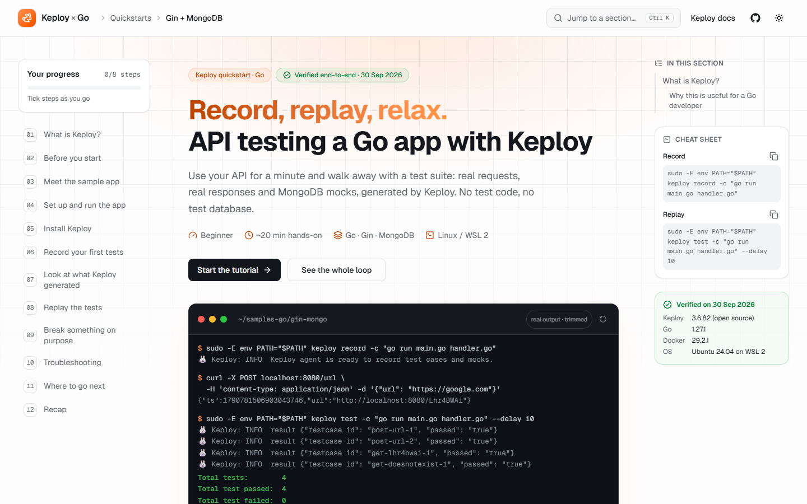

# Record, Replay, Relax: API Testing a Go App with Keploy

A beginner-friendly tutorial for [Keploy](https://keploy.io), written from my own end-to-end run of the **Gin + MongoDB** Go quickstart and published as a single-page documentation site built with **Next.js** and **MDX**.

**Live site:** _coming soon (Vercel)_

<picture>
  <source media="(prefers-color-scheme: dark)" srcset="docs/preview-dark.png">
  
</picture>

## What's in the tutorial

- What Keploy is, and why generating tests from real traffic is useful for Go developers
- Running the sample URL-shortener API (Gin + MongoDB) locally on Linux / WSL 2
- Recording test cases and MongoDB mocks with `keploy record`
- Replaying them with `keploy test`, including with the database switched off
- Breaking a response on purpose to watch Keploy catch the regression
- Troubleshooting for the issues I actually hit, plus common ones

Every command and output on the page comes from a real run (Keploy 3.6.82, Go 1.27.1, Ubuntu 24.04 on WSL 2, 30 Sep 2026).

## Features

**Content**
- The whole tutorial lives in [`app/page.mdx`](app/page.mdx): Markdown mixed with React components
- Custom MDX components: `Callout`, `Steps`/`Step`, `KeployFlow` (animated record/replay diagram), `Term` (glossary hover cards), `QuickLoop`, `Screenshot`, `Hero`
- Build-time syntax highlighting with Shiki (`rehype-pretty-code`), with light and dark themes; code blocks show terminal chrome, filename tabs or output styling, and a copy button

**Reading experience**
- Three-column docs layout: section nav with step progress, content, and a right rail with section contents, a command cheat sheet and the verified environment
- Clickable step markers; progress is saved in the browser
- `Ctrl`/`⌘` + `K` palette to jump to any section or step
- Reading progress bar, dark/light mode with no flash, mobile navigation drawer
- Responsive from 320px to wide desktop screens; respects `prefers-reduced-motion`

**Under the hood**
- Fully static: prerendered at build time, no server or database
- Navigation is built from the MDX source at build time, so it's part of the static HTML
- Generated Open Graph image for link previews

## Tech stack

| | |
|---|---|
| Framework | [Next.js](https://nextjs.org) 16 (App Router) + TypeScript |
| Content | [MDX](https://mdxjs.com) via `@next/mdx`, `remark-gfm`, `rehype-slug`, `rehype-pretty-code` |
| Styling | [Tailwind CSS](https://tailwindcss.com) v4, Keploy's brand orange (`#ff914d`) |
| Components | [shadcn/ui](https://ui.shadcn.com) on Radix: Tabs, Accordion, Command, Dialog, Sheet, HoverCard, Progress, Badge, Button |
| Theming | [next-themes](https://github.com/pacocoursey/next-themes) |
| Icons | [lucide](https://lucide.dev) |
| Hosting | [Vercel](https://vercel.com) |

## Run it locally

Requires Node.js 20.9 or newer.

```bash
npm install
npm run dev
```

Open http://localhost:3000.

Other scripts:

```bash
npm run build   # production build (static)
npm run start   # serve the production build
npm run lint    # ESLint
```

## Project structure

```text
app/
  page.mdx              the tutorial
  layout.tsx            HTML shell: fonts, theme, header, sidebars, footer
  globals.css           Tailwind, brand tokens, docs typography, code-block styles
  opengraph-image.tsx   link-preview image, generated at build time
components/
  mdx/                  components used inside the MDX (Hero, Callout, Steps, CodeBlock, ...)
  docs/                 layout pieces (sidebar, right rail, command menu, mobile nav, ...)
  ui/                   shadcn/ui primitives
lib/
  outline.ts            builds the section outline from page.mdx at build time
  progress-store.ts     step progress, persisted in localStorage
  site.ts               links and facts used across the site
mdx-components.tsx      maps MDX tags (and Markdown elements like <pre>) to React components
next.config.ts          enables MDX and its remark/rehype plugins
```

## How the MDX pipeline works

At build time `@next/mdx` compiles `app/page.mdx` into a React component. `remark-gfm` adds tables, `rehype-slug` gives headings their anchor ids, and `rehype-pretty-code` highlights code with Shiki, so the browser receives colored code as plain HTML. `mdx-components.tsx` tells MDX which React component to render for `<Callout>`, `<Steps>` and the other custom tags, and swaps Markdown's `<pre>` for the code-block component. Everything renders as Server Components except the interactive pieces (theme toggle, copy buttons, step progress, command menu, sidebars, tabs, accordion, hero terminal).

## Credits

The tutorial is based on Keploy's official [Gin + MongoDB quickstart](https://keploy.io/docs/quickstart/samples-gin/) and the [samples-go](https://github.com/keploy/samples-go/tree/main/gin-mongo) repository. The explanations, structure and troubleshooting notes are my own.
